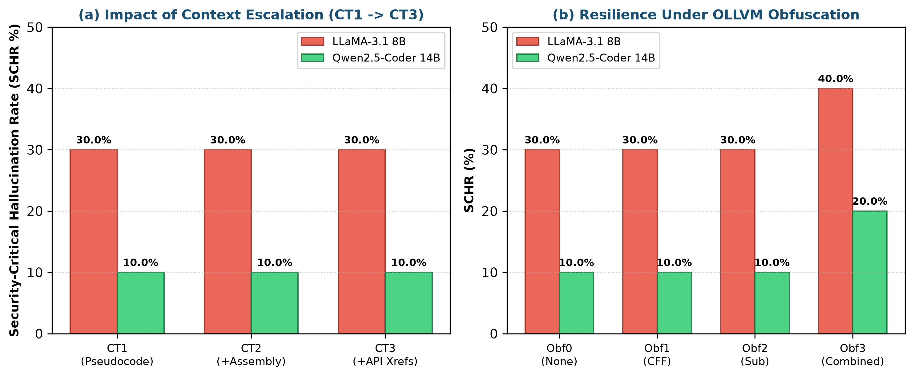
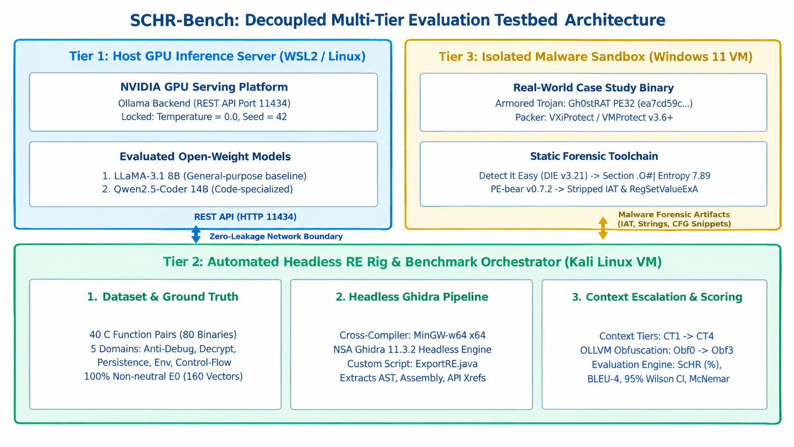

<div align="center">

# 🔬 SCHR-Bench: Binary Differential LLM Auditing Benchmark
### *Evaluating Security-Critical Hallucinations in LLM-Assisted Binary Reverse Engineering via Ground-Truth Mutations*

[](https://github.com/phat1310/IAM302t_SCHR_Bench/actions)
[](https://www.python.org/)
[-00599C.svg?logo=c&logoColor=white)](dataset/SCHR_Bench_C_Functions/)
[](results/)
[](LICENSE)
[](LICENSE)

[**⚡ 1-Command Quickstart**](#-4-one-command-reproducibility-quickstart) •
[**📊 Empirical Findings**](#-2-headline-empirical-results-n--80-variants-1020-runs) •
[**🏗️ Architecture**](#-3-benchmark-architecture--mutation-taxonomy) •
[**📂 Repository Layout**](#-5-repository-structure) •
[**🇻🇳 Tóm Tắt Tiếng Việt (FPT IAM302t)**](#-7-tóm-tắt-dự-án-học-phần-iam302t--đại-học-fpt-vietnamese-summary)

</div>

---

## 🎯 1. Executive Summary (TL;DR for Security Engineers & Recruiters)

Large Language Models (LLMs) are increasingly integrated into binary reverse-engineering workflows (e.g., Ghidra/IDA MCP plugins) to summarize stripped executables and triage vulnerabilities. However, **when a stripped binary differs from a canonical cryptographic, authentication, or bounds-checking routine by a single operator mutation**, do LLMs actually trace the decompiled control/data flow—or do they hallucinate the unmutated textbook algorithm?

**SCHR-Bench** is a ground-truth binary mutation and differential auditing benchmark comprising **40 security-critical C function pairs ($N = 80$ stripped x86\_64 Windows PE executables compiled with MinGW-w64 `-O2 -s`)**, verified across **160 dynamic execution assertions** and **1,020 deterministic LLM evaluations** (`llama3.1:8b` and `qwen2.5-coder:14b` at $\tau = 0.0$).

### 🔥 Three Key Empirical Discoveries

1. **100% Canonical Parroting on Unnoticed Mutations:**
   When a model correctly computes the output of an original binary but fails on its single-operator mutant, it outputs the **exact return value of the unmutated original routine in 100% of cases** (**13/13** for `llama3.1:8b`; **9/9** for `qwen2.5-coder:14b`), proving that LLM errors on stripped binaries are driven by *canonical template memorization* rather than random arithmetic slips.
2. **Low Pair-Level Discrimination Despite Raw Disassembly (`CT2`) & CFG Hints (`CT3`):**
   Evaluating both variants of a pair simultaneously reveals that **Joint Pair-Level Accuracy** reaches only **25.0% (10/40 pairs)** for `llama3.1:8b` and **57.5% (23/40 pairs)** for `qwen2.5-coder:14b` on stripped pseudocode (`CT1`). Appending raw Intel `objdump` assembly (`CT2`) or structured Control-Flow Graph (CFG) metadata (`CT3`) yields **no statistically significant improvement** across either open-ended execution tracing or our 240-item Full-Factorial Gold Set MCQ ($p \in [0.3588, 1.0000]$ via exact McNemar's test).
3. **Lightweight Pairwise BLEU Regression Screening (Up to 0.811 AUROC):**
   Because LLMs recycle nearly identical natural-language explanations when failing to notice a binary patch, **pairwise explanation similarity (BLEU) between Original and Mutant** acts as a practical, reference-free detector for silent patch-regression failures—achieving **AUROC up to 0.811** (`qwen2.5-coder:14b` at `CT2`) and **0.800** (`llama3.1:8b` at `CT3`).

---

## 📊 2. Headline Empirical Results ($N = 80$ Variants, 1,020 Runs)

<p align="center">
  
</p>

### 2.1. Layer 1: Concrete Execution Tracing & Pairwise Differential Auditing ($N = 80$ Binaries / Tier)

| Model ($\tau=0.0$) | Context Tier | Overall SCHR (Errors / 80) | 95% Wilson CI | Orig Err ($N=40$) | Mut Err ($N=40$) | Pair Acc. (Both OK) | Canonical Parroting | McNemar $p$ (vs. CT1) | Pairwise BLEU (OK vs. Err) | Screening AUROC [95% CI] |
| :--- | :---: | :---: | :---: | :---: | :---: | :---: | :---: | :---: | :---: | :---: |
| `llama3.1:8b` | **CT1** (Pseudocode) | **38.8%** (31/80) | `[28.8%, 49.7%]` | 42.5% (17) | 35.0% (14) | **25.0%** (10/40) | **100%** (13/13) | — | `0.334` vs. `0.506` | `0.683 [0.461, 0.878]` |
| `llama3.1:8b` | **CT2** (+`objdump` ASM) | **36.2%** (29/80) | `[26.6%, 47.2%]` | 40.0% (16) | 32.5% (13) | **30.0%** (12/40) | **100%** (11/11) | `0.7518` | `0.320` vs. `0.489` | `0.670 [0.472, 0.845]` |
| `llama3.1:8b` | **CT3** (+CFG Metadata) | **37.5%** (30/80) | `[27.7%, 48.5%]` | 37.5% (15) | 37.5% (15) | **30.0%** (12/40) | **100%** (13/13) | `1.0000` | `0.264` vs. `0.556` | **`0.800 [0.649, 0.931]`** |
| `qwen2.5-coder:14b` | **CT1** (Pseudocode) | **23.8%** (19/80) | `[15.8%, 34.1%]` | 20.0% (8) | 27.5% (11) | **57.5%** (23/40) | **100%** (9/9) | — | `0.289` vs. `0.481` | `0.747 [0.574, 0.890]` |
| `qwen2.5-coder:14b` | **CT2** (+`objdump` ASM) | **20.0%** (16/80) | `[12.7%, 30.0%]` | 15.0% (6) | 25.0% (10) | **65.0%** (26/40) | **100%** (8/8) | `0.4497` | `0.191` vs. `0.584` | **`0.811 [0.651, 0.934]`** |
| `qwen2.5-coder:14b` | **CT3** (+CFG Metadata) | **23.8%** (19/80) | `[15.8%, 34.1%]` | 17.5% (7) | 30.0% (12) | **55.0%** (22/40) | **100%** (11/11) | `1.0000` | `0.289` vs. `0.423` | `0.595 [0.393, 0.790]` |

---

### 2.2. Layer 2: Full-Factorial Paired Gold Set Multiple-Choice Evaluation (240 Items / Model)

To decouple semantic comprehension from arithmetic calculation, we evaluate both models on **240 balanced, length-neutral 4-way MCQs** ($N = 80$ variants $\times 3$ tiers; exact `60 A / 60 B / 60 C / 60 D` ground-truth distribution; longest-option heuristic $= 25.0\%$ chance level):

| Model ($\tau=0.0$) | CT1 MCQ SCHR ($N=80$) | CT2 MCQ SCHR ($N=80$, +ASM) | CT3 MCQ SCHR ($N=80$, +CFG) | Overall MCQ SCHR ($N=240$) | 95% Wilson CI ($N=240$) | Correct / Total |
| :--- | :---: | :---: | :---: | :---: | :---: | :---: |
| `llama3.1:8b` | **38.8%** (31/80) | **45.0%** (36/80, $p=0.4042$) | **38.8%** (31/80, $p=1.0000$) | **40.8%** | `[34.8%, 47.1%]` | `142 / 240` |
| `qwen2.5-coder:14b` | **21.2%** (17/80) | **26.2%** (21/80, $p=0.4533$) | **27.5%** (22/80, $p=0.3588$) | **25.0%** | `[19.9%, 30.8%]` | `180 / 240` |

---

## 🏗️ 3. Benchmark Architecture & Mutation Taxonomy

<p align="center">
  
</p>

### 3.1. Five Security Domains $\times$ Five Controlled Mutation Operators ($40$ Pairs, $N = 80$ PE64 Binaries)

- **Security Domains (8 Pairs / 16 Binaries per Domain):**
  1. `C01–C08` (**Cryptographic Primitives**): TEA/XTEA rounds, CRC32 polynomials, DJB2/FNV-1a hashes, RC4 PRGA, XOR stream ciphers.
  2. `A01–A08` (**Authentication & Access Control**): Constant-time MAC comparison, PIN lockouts, RBAC bitmasks, OTP time-window checks, session token expiry.
  3. `P01–P08` (**Protocol & Packet Parsing**): IPv4 header length validation, TLV bounds checking, DNS label decompression, sequence number wrap-around.
  4. `S01–S08` (**Memory & Bounds Safety**): Ring-buffer wrap checks, integer overflow multiplication guards, stack canary checks, array slice bounds.
  5. `E01–E08` (**Anti-Analysis & Evasion Logic**): Timing-delta RDTSC checks, PEB `BeingDebugged` flags, API hash resolution, VM hypervisor port checks.
- **Controlled Single-Site Mutation Operators (`M1`–`M5`, 8 Pairs / 16 Binaries per Operator):**
  - `M1`: Relational Boundary Flip (`<` $\leftrightarrow$ `<=`, `>` $\leftrightarrow$ `>=`)
  - `M2`: Bitwise / Shift Mask Corruption (`>>` $\leftrightarrow$ `<<`, bitmask width alteration)
  - `M3`: Arithmetic Sign / Modulo / Overflow Modification (`+` $\leftrightarrow$ `-`, modulus change)
  - `M4`: Equality / Polarity Inversion (`==` $\leftrightarrow$ `!=`, boolean return inversion)
  - `M5`: Compound Guard / State-Reset Perturbation (`&&` $\leftrightarrow$ `||`, accumulator init shift)

---

## ⚡ 4. One-Command Reproducibility Quickstart

The benchmark supports **three reproducible execution modes** out of the box:

### Mode A: Offline Verification & Statistical Reproduction (No GPU / No Ollama Required — Runs in `< 15s`)
Executes all 80 PE64 binaries across 160 dynamic input assertions (`check_suite.py` & `step0_verify_e0_windows.py`), regenerates leak-free decompiled contexts (`extract_contexts.py`), reproduces all statistical tables (`step4_compute_statistics_and_tables.py`), and verifies the 20-pair Q4/FP16 ablation baseline (`step5_fp16_api_subset_ablation.py`):
```bash
bash reproduce.sh
```
*(On Windows PowerShell without Bash, you can run each Python step directly:)*
```powershell
python dataset/SCHR_Bench_C_Functions/tools/check_suite.py
python code/step0_verify_e0_windows.py
python code/extract_contexts.py
python code/step4_compute_statistics_and_tables.py
python code/step5_fp16_api_subset_ablation.py --baseline-only
```

### Mode B: Full Live LLM Re-Evaluation (Requires Local Ollama Server with `llama3.1:8b` & `qwen2.5-coder:14b`)
```bash
bash reproduce.sh --live-ollama
```

### Mode C: 20-Pair Stratified Unquantized FP16 / Cloud API Control Protocol
To evaluate an unquantized `FP16` model (via vLLM/Ollama) or a frontier cloud model (via any OpenAI-compatible API) against our 4-bit quantized baseline on the stratified 20-pair ($N = 40$) subset:
```bash
python code/step5_fp16_api_subset_ablation.py \
    --api-base http://localhost:11434/v1 \
    --model qwen2.5-coder:14b-fp16 \
    --output results/fp16_ablation_logs.json
```

---

## 📂 5. Repository Structure

```text
IAM302t_SCHR_Bench/
├── 📁 .github/workflows/       # Automated CI pipeline (Ubuntu statistical + Windows x64 PE64 execution)
├── 📁 code/                    # Core benchmark & statistical verification pipeline
│   ├── step0_verify_e0_windows.py             # Dynamic E0 binary execution verifier (80 PE64 binaries, 160 assertions)
│   ├── extract_contexts.py                    # Leak-free context builder (CT1-CT4, Obf0-Obf3 + real objdump ASM)
│   ├── step3_mcp_server_and_benchmark.py      # Deterministic LLM evaluation harness (--mode return & --mode mcq)
│   ├── step4_compute_statistics_and_tables.py # Non-parametric statistical engine (Wilson CI, McNemar, Spearman, AUROC)
│   ├── step5_fp16_api_subset_ablation.py      # Stratified 20-pair (N=40) Q4 vs. FP16/Cloud API control protocol
│   ├── generate_paper_macros.py               # Single Source of Truth (SSOT) LaTeX macro generator
│   └── evaluate_gh0strat_case_study.py        # Ecological packed malware static triage verifier
├── 📁 dataset/                 # Ground-truth C pairs, stripped PE64 binaries, objdump ASM & 240-item MCQ suite
│   ├── SCHR_Bench_C_Functions/src/            # 40 Original + 40 Mutant C source files (80 variants)
│   ├── SCHR_Bench_C_Functions/bin/pe_x64_O2/  # 80 compiled & stripped x86_64 Windows PE executables (.exe)
│   ├── SCHR_Bench_C_Functions/disassembly_objdump_80.json # Real Intel-syntax objdump disassembly
│   ├── SCHR_Bench_C_Functions/ground_truth_manifest.json  # Pair metadata, M1-M5 tags & 160 test assertions
│   └── gold_set_mcq.json                      # 240 Full-Factorial paired, balanced, length-neutral MCQs
├── 📁 results/                 # Complete 1,020 raw LLM evaluation logs & auto-generated statistical tables
│   ├── benchmark_raw_logs.json                # 540 Layer 1 Return-Value & Explanation logs (480 core + 60 E4 pilot)
│   ├── benchmark_mcq_logs.json                # 480 Layer 2 Full-Factorial Gold Set MCQ logs (240 items x 2 models)
│   ├── decompiled_contexts_80.json            # Normalized leak-free decompiled contexts for all 80 PE64 binaries
│   └── PAPER_TABLES_SPRINGER.md               # Auto-generated publication tables (Sections 1-7)
├── 📁 manuscript/              # Springer LNICST / JCVHT & IEEE Conference LaTeX sources and figures
├── 📁 prompts/                 # System prompt templates for concrete execution tracing and MCQ evaluation
├── 📁 documentation/           # Project master plan, ecological checklist & peer-review response audit
├── 📄 CITATION.cff             # Citation File Format metadata
├── 📄 CONTRIBUTING.md          # Guide for adding C mutation pairs and evaluating new LLMs
├── 📄 SECURITY.md              # Artifact safety policy (100% synthetic C binaries, static-only malware data)
├── 📄 LICENSE                  # MIT License (Code) & CC BY 4.0 (Dataset)
└── 📄 reproduce.sh             # 1-command reproducibility pipeline (Offline default & --live-ollama)
```

---

## 📝 6. Citation (BibTeX)

If you use **SCHR-Bench**, its 80-binary PE64 mutation dataset, or our pairwise BLEU regression screening methodology in your research, please cite:

```bibtex
@article{nguyen2026schrbench,
  author    = {Nguyen, Tan-Phat and Do, Thien-Nhan and Nguyen, Trong-Duy and Vo, Hong-Phuc and Dinh, Mai-Hoang},
  title     = {{SCHR-Bench}: Evaluating Security-Critical Hallucinations in {LLM}-Assisted Binary Reverse Engineering via Ground-Truth Mutations},
  journal   = {Journal of Computer Virology and Hacking Techniques},
  publisher = {Springer},
  year      = {2026},
  url       = {https://github.com/phat1310/IAM302t_SCHR_Bench}
}
```

---

## 🇻🇳 7. Tóm Tắt Dự Án Học Phần IAM302t — Đại Học FPT (Vietnamese Summary)

Dự án **SCHR-Bench** được phát triển trong khuôn khổ học phần **IAM302t (Malware Analysis and Reverse Engineering)** tại **Trường Đại học FPT Phân hiệu TP. Hồ Chí Minh** theo phương pháp **Research-Based Learning (RBL)**.

### 👥 Thành Viên Nhóm Nghiên Cứu (Group 7 — Lớp IA2007)

| STT | Họ và Tên | MSSV | Vai trò nghiên cứu & kỹ thuật |
| :---: | :--- | :---: | :--- |
| 1 | **Nguyễn Tấn Phát** | `SE173285` | **Group Leader & Pipeline Co-Engineer** (Kiến trúc tổng thể, LLM Evaluation Harness, CI/CD & LaTeX Manuscript) |
| 2 | **Đỗ Thiện Nhân** | `SE194134` | **C/Binary & Mutation Engineer** (Thiết kế 40 cặp hàm C chuẩn, biên dịch 80 file PE64 `-O2 -s` & kiểm định E0) |
| 3 | **Nguyễn Trọng Duy** | `SE194413` | **Context Extractor & Metrics Specialist** (Trích xuất ngữ cảnh chống rò rỉ nhãn `CT1–CT3`, `objdump` ASM & 240 câu MCQ) |
| 4 | **Võ Hồng Phúc** | `SE203844` | **Statistical Analyst & Manuscript Co-Author** (Kiểm định Wilson CI, McNemar, Spearman $\rho$, Bootstrap AUROC & Case Study) |

* **Giảng viên hướng dẫn (Corresponding Author):** Thầy **Mai Hoàng Đỉnh** (`dinhmh@fe.edu.vn`) — Bộ môn An toàn Thông tin (Department of Information Assurance), Trường Đại học FPT TP. Hồ Chí Minh.

### 🛡️ Cam Kết An Toàn & Đạo Đức Nghiên Cứu (Artifact Safety & No Dual Submission)
- **An toàn thực thi (`SECURITY.md`):** Toàn bộ 80 file thực thi `.exe` trong `dataset/SCHR_Bench_C_Functions/bin/pe_x64_O2/` được biên dịch từ 80 hàm C thuần tính toán số học/bit (`int target(int a, int b, int c)`), hoàn toàn không chứa mã độc và không gọi API hệ thống hay mạng. Đối với nghiên cứu tình huống mẫu Gh0stRAT đóng gói VMProtect, kho mã nguồn **tuyệt đối không lưu trữ mẫu thực thi mã độc**, chỉ lưu trữ dữ liệu phân tích tĩnh đã làm sạch (`results/GH0STRAT_EVALUATION.json`).
- **Định dạng bản thảo (`manuscript/`):** Kho mã nguồn cung cấp bản thảo chuẩn **Springer** (`manuscript/02_Springer_LNICST_Format_10_14_Pages/`) và bản thảo định dạng **IEEE Conference** (`manuscript/01_IEEE_Conference_Format_8_10_Pages/`) phục vụ nghiệm thu học phần IAM302t, tuân thủ nghiêm ngặt nguyên tắc **No Dual Submission**.
