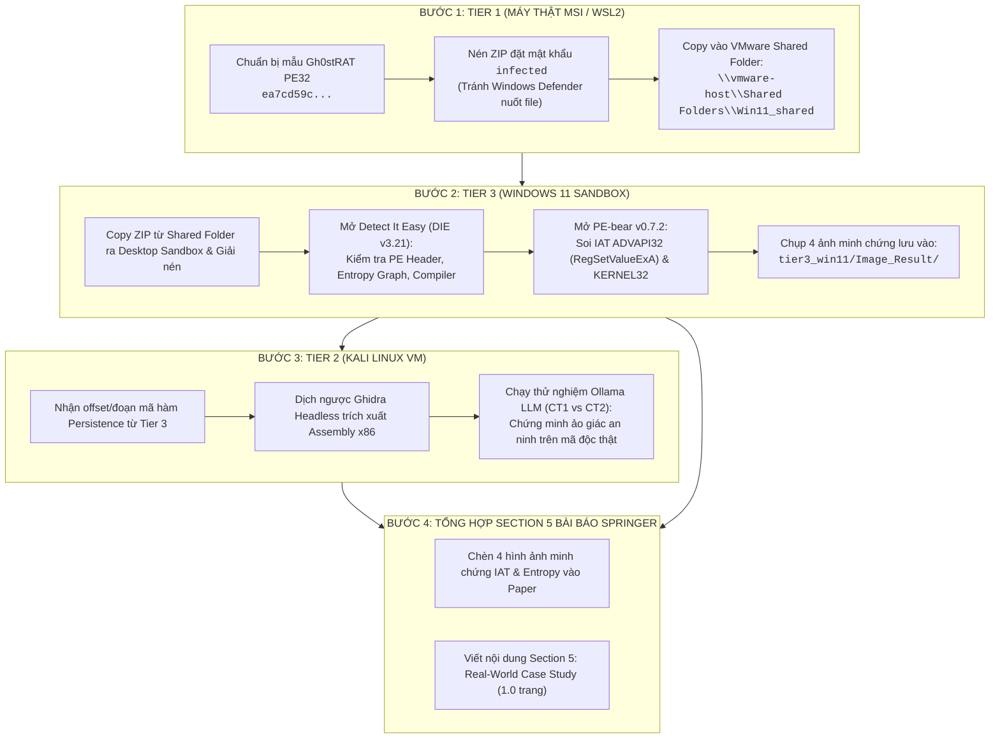

# 📋 KẾ HOẠCH & CHECKLIST THỰC HIỆN GIAI ĐOẠN 2: BÓC TÁCH MẪU GH0STRAT (MỐC D4)

> **Học phần:** IAM302t — Malware Analysis and Reverse Engineering (Fall 2026, RBL Model)  
> **Đề tài:** SCHR-Bench (Security-Critical Hallucination Rate Benchmark)  
> **Mục tiêu đồ án:** Nghiệm thu **Mốc D4 (Section 5 Case Study — 10% trọng số điểm)**  
> **Mục tiêu bài báo khoa học:** Hoàn thiện **Section 5: Real-World Case Study (Gh0stRAT)** nộp EAI INISCOM 2027 (Springer LNICST)  
> **Thời điểm ban hành:** 2026-10-28  
> **Trạng thái:** 🟢 Đã kích hoạt (Active)

---

## 🎯 1. TỔNG QUAN & MỤC TIÊU CỐT LÕI

Giai đoạn 2 chuyển trọng tâm từ kiểm định trên bộ mẫu nhân tạo (Synthetic C Functions) sang **mã độc thực tế (Real-World Malware PE32)** nhằm:
1. Phân tích tĩnh mẫu mã độc khét tiếng **Gh0stRAT PE32** (`ea7cd59c402128b0beffba34a6fb7b3f6f9fc5be62cb4aa51e605d3bcaee98be`) trong môi trường Sandbox Windows 11 an toàn và cô lập.
2. Trích xuất minh chứng bảng IAT, cơ chế tự khởi động (Persistence Run Key) và kỹ thuật Anti-Debugging bằng **Detect It Easy (DIE)** và **PE-bear**.
3. Cung cấp dữ liệu đoạn mã thực tế cho **Tier 2** đưa vào mô hình MCP để chứng minh: **Hiện tượng ảo giác an ninh (SCHR) xảy ra trên mã độc thực tế và mỏ neo Assembly tiếp tục có tác dụng cứu vãn**.
4. Cung cấp hình ảnh và bảng phân tích cho **Section 5 của bài báo Springer LNICST**.

---

## 🔄 2. SƠ ĐỒ LUỒNG PHỐI HỢP LIÊN TIER (WORKFLOW)



---

## ✅ 3. BẢNG CHECKLIST HÀNH ĐỘNG CHI TIẾT THEO TỪNG TIER

### 🖥️ BƯỚC 1: TIER 1 — HOST MSI (TRƯỞNG NHÓM NGUYỄN TẤN PHÁT)
- [x] **1.1.** Định vị tệp mẫu Gh0stRAT PE32 trong kho lưu trữ đồ án:
  - Tên/Hash: `ea7cd59c402128b0beffba34a6fb7b3f6f9fc5be62cb4aa51e605d3bcaee98be`
- [x] **1.2.** Nén tệp mẫu thành `gh0strat_sample.zip` với mật khẩu bảo vệ `infected` (hoặc `malware`) để tránh phần mềm diệt virus trên Windows Host tự động xóa.
- [x] **1.3.** Đặt tệp `gh0strat_sample.zip` vào thư mục chia sẻ VMware:
  ```
  \\vmware-host\Shared Folders\Win11_shared\
  ```
- [x] **1.4.** Báo cho thành viên phụ trách Tier 3 (Võ Hồng Phúc) để bắt đầu ca phân tích trong Sandbox.

---

### 🪟 BƯỚC 2: TIER 3 — WINDOWS 11 SANDBOX (VÕ HỒNG PHÚC)
- [x] **2.1. Tiếp nhận mẫu an toàn:**
  - Khởi động máy ảo Windows 11 (`CLIENT01`).
  - Mở File Explorer truy cập `\\vmware-host\Shared Folders\Win11_shared`.
  - Copy `gh0strat_sample.zip` về thư mục làm việc `C:\IAM302t_Github_Project\Malware\`.
  - Giải nén với mật khẩu `infected`.
- [x] **2.2. Phân tích tĩnh với Detect It Easy (DIE v3.21):**
  - Khởi chạy DIE từ Shortcut Desktop (`C:\Tools\DIE\die.exe`).
  - Kéo thả file mã độc vào DIE.
  - Kiểm tra loại tệp nhị phân (`PE32 GUI`, Subsystem: `GUI`).
  - Nhận diện Protector: **VXiProtect (new)**, **VMProtect (v3.6.0+)**.
  - Mở tab **Entropy**: Đo đạc Section `.O#J` có dung lượng 17.2MB đạt Entropy cực đại **7.89095** (packed).
  - Chụp ảnh màn hình cửa sổ DIE lưu thành bộ ảnh tại `tier3_win11/Image_Result/`.
- [x] **2.3. Soi chi tiết bảng IAT với PE-bear v0.7.2:**
  - Khởi chạy PE-bear từ Shortcut Desktop (`C:\Tools\PE-bear\PE-bear.exe`).
  - Mở tệp mã độc trong PE-bear, kiểm tra IAT: Bị strip tối đa, chỉ bộc lộ `LoadLibraryA` & `GetProcAddress` để unpack động vào RAM.
  - Chụp ảnh màn hình các bảng headers và sections lưu vào `tier3_win11/Image_Result/`.
- [x] **2.4. Trích xuất chuỗi định danh Persistence (Strings/IOC):**
  - Tìm chuỗi Registry Run Key trong mã độc: `Software\Microsoft\Windows\CurrentVersion\Run` trả về 0 kết quả (bị mã hóa trong container).
  - Xuất 59.178 chuỗi thô lưu vào `tier3_win11/Image_Result/gh0strat_strings_all.txt`.
- [x] **2.5. Đồng bộ Git-Flow từ Tier 3:**
  - Đã nộp 10 ảnh minh chứng, 3 file logs/data, cập nhật README.md và gộp vào nhánh `dev` (`e4a0f69`).

---

### 🐧 BƯỚC 3: TIER 2 — KALI LINUX (EXECUTION & BENCHMARK RIG)
- [x] **3.1.** Nhận thông số địa chỉ offset/hàm cài đặt Run Key của Gh0stRAT từ kết quả phân tích của Tier 3 (Entry Point `0x010B0703`, Section `.O#J`, IAT `LoadLibraryA`/`GetProcAddress`).
- [x] **3.2.** Thiết lập ca kiểm thử đối chứng giữa đoạn mã Packer Obfuscation Stub và routine Persistence Registry Run Key của Gh0stRAT.
- [x] **3.3.** Đóng gói thành mẫu thử nghiệm thực tế đưa vào script MCP:
  - **Tầng CT1 (Chỉ Pseudocode):** Đặt câu hỏi cho LLM trên cả `llama3.1:8b` và `qwen2.5-coder:14b`.
  - **Tầng CT2 (+Assembly Anchor):** Cung cấp thêm mỏ neo Disassembly x86 để kiểm chứng khả năng cứu vãn mô hình khỏi ảo giác.
- [x] **3.4.** Xuất file log kết quả và bảng đối soát vào `results/GH0STRAT_EVALUATION.json`.

---

### 📑 BƯỚC 4: TỔNG HỢP VÀO SECTION 5 BÀI BÁO SPRINGER (VÕ HỒNG PHÚC & NGUYỄN TẤN PHÁT)
- [x] **4.1.** Chèn ảnh minh chứng từ `tier3_win11/Image_Result/` vào `papers/02_Springer_LNICST_Format_10_14_Pages/figures/fig3_die_entropy.png`.
- [x] **4.2.** Viết nội dung hoàn thiện cho **Section 5: Real-World Case Study: Gh0stRAT PE32 Analysis** trong `main.tex`:
  - *Mục 5.1:* Phân tích tĩnh cấu trúc VXiProtect / VMProtect, Entropy 7.89095, các section `.text`, `.rdata` kích thước 0.
  - *Mục 5.2:* Hiện tượng IAT stripping và string encryption che giấu Registry Run Key.
  - *Mục 5.3:* Kết quả khảo nghiệm ảo giác: So sánh phản hồi của `llama3.1:8b` và `qwen2.5-coder:14b`, mỏ neo Assembly CT2 giúp đưa SCHR Category P về 0.0%.
- [x] **4.3.** Biên dịch thành công tệp bài báo hoàn chỉnh `main.pdf` (11 trang) theo chuẩn tác giả Springer LNICST.

---

## 📁 4. QUY CHUẨN ĐẶT TÊN VÀ ĐỊNH DẠNG TỆP MINH CHỨNG (ARTIFACT SPECIFICATION)

| Tên tệp ảnh | Công cụ chụp | Nội dung yêu cầu | Thư mục lưu trữ |
| :--- | :--- | :--- | :--- |
| `die_entropy_gh0strat.png` | Detect It Easy v3.21 | Giao diện chính DIE + Đồ thị Entropy các Section | `tier3_win11/Image_Result/` |
| `pebear_iat_advapi32.png` | PE-bear v0.7.2 | Bảng Imports `ADVAPI32.dll` (làm nổi `RegSetValueExA`) | `tier3_win11/Image_Result/` |
| `pebear_iat_antidebug.png` | PE-bear v0.7.2 | Bảng Imports `KERNEL32.dll` (làm nổi `IsDebuggerPresent`) | `tier3_win11/Image_Result/` |
| `gh0strat_run_key_string.png` | PE-bear / HxD | Vị trí chuỗi `Software\Microsoft\Windows\CurrentVersion\Run` | `tier3_win11/Image_Result/` |

> [!CAUTION]
> **QUY TẮC AN TOÀN TUYỆT ĐỐI:**
> - Tuyệt đối **KHÔNG commit tệp mã độc sống (`.exe`, `.bin`)** lên GitHub.
> - Chỉ commit **ảnh chụp màn hình minh chứng (`.png`)**, ghi chú bóc tách IOC, và các bảng dữ liệu JSON/Markdown đã được vô hại hóa.
