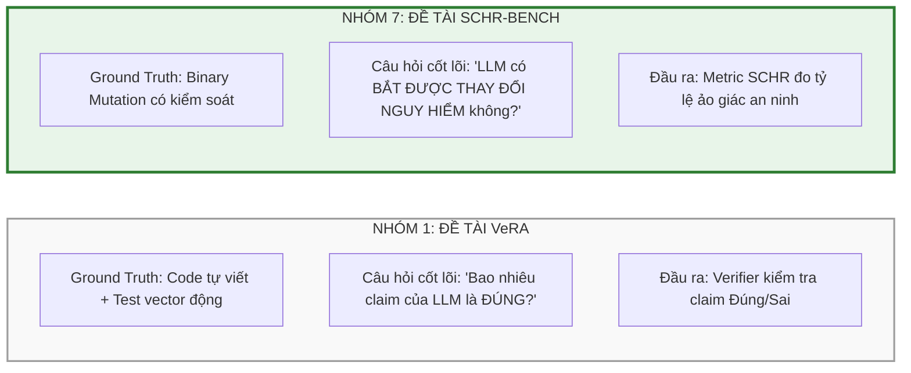

# 🌿 SCHR-BENCH: MASTER RESEARCH & IMPLEMENTATION VAULT
> <span style="color:#2e7d32; font-size:1.1em; font-weight:bold;">Đo Lường Ảo Giác An Ninh (Security-Critical Hallucination) của LLM trong Reverse Engineering bằng Ground Truth Đột Biến Nhị Phân</span>

---

> [!success] **ĐỊNH VỊ CHIẾN LƯỢC CỦA ĐỒ ÁN (DUAL-GOAL STRATEGY)**
> 1. **Mục tiêu Học phần (IAM302t - RBL):** Hoàn thành xuất sắc 5 mốc Deliverables (D1 $\rightarrow$ D5), kiểm định toàn diện mã nhị phân tĩnh/động, Live Demo mượt mà và bảo vệ đồ án đạt điểm tối đa.
> 2. **Mục tiêu Xuất bản Quốc tế (Academic Paper):** Đóng gói bộ thực nghiệm thành bài báo khoa học chuẩn **Springer LNICST** (8–10 trang) nộp cho hội nghị quốc tế **EAI INISCOM 2027** (Scopus/EI Compendex Indexed).

---

### 📌 THÔNG TIN ĐỒ ÁN & HỘI ĐỒNG HƯỚNG DẪN

* **Cơ sở đào tạo:** Trường Đại học FPT — Phân hiệu TP. Hồ Chí Minh
* **Bộ môn:** An toàn Thông tin (Information Assurance — IA)
* **Học phần:** IAM302t — Phân tích Mã độc và Kỹ thuật Dịch ngược (Malware Analysis & Reverse Engineering)
* **Giảng viên hướng dẫn:** <mark style="background:#e8f5e9; color:#1b5e20; font-weight:bold;">Thầy Đinh Mai Hoàng (DINHMH)</mark>
* **Hội nghị mục tiêu:** **EAI INISCOM 2027** — The 13th EAI International Conference on Industrial Networks and Intelligent Systems
* **Ấn phẩm kỷ yếu:** Springer Nature — LNICST Series (Lecture Notes of the Institute for Computer Sciences, Social Informatics and Telecommunications Engineering)

---

### 👥 PHÂN CÔNG VAI TRÒ THÀNH VIÊN NHÓM 7 (RACI MATRIX)

| STT | Thành viên | Mã số SV | Vai trò nòng cốt | Nhiệm vụ chính & Sản phẩm phụ trách |
| :---: | :--- | :---: | :--- | :--- |
| 1 | **Nguyễn Tấn Phát** | **SE173285** | **Group Leader & Pipeline Co-Engineer** | • Điều phối tổng thể 10 tuần, quản trị mốc tiến độ D1–D5.<br>• Viết script Ghidra Headless + MCP Pipeline kết nối Ollama.<br>• Phân tích định tính mẫu Gh0stRAT PE32; chủ trì bài báo Springer. |
| 2 | **Đỗ Thiện Nhân** | **SE194134** | **C/Binary & Mutation Engineer** | • Xây dựng bộ dataset 40 hàm C bảo mật tự viết (A, S, P, E, C).<br>• Cài đặt 5 toán tử đột biến nhị phân; biên dịch GCC/MinGW-w64.<br>• Phụ trách Thí nghiệm E0 (Sanity Check) & hoàn tất mốc **D2**. |
| 3 | **Nguyễn Trọng Duy** | **SE194413** | **Decompiler & Metrics Specialist** | • Cùng Phát tự động hóa Ghidra Headless bóc tách JSON.<br>• Thiết kế Gold Set MCQ (120 cặp câu hỏi có nhãn ẩn).<br>• Viết Python script tính SCHR, BLEU, Recompilability; phụ trách **Live Demo D3**. |
| 4 | **Võ Hồng Phúc** | **SE203844** | **Statistical Analyst & Lead Author** | • Thực hiện kiểm định thống kê chuyên sâu (McNemar Test, Wilson CI).<br>• Phân loại lỗi ảo giác chất lượng (Missed mutation, Fabricated API).<br>• Phân tích đối chiếu mẫu Gh0stRAT; đồng tác giả bài báo khoa học. |

---

### 💡 NỀN TẢNG HỌC THUẬT & QUÁ TRÌNH TÁI ĐỊNH VỊ ĐỀ TÀI

> [!tip] **LÝ DO CHUYỂN HƯỚNG TỪ PROPOSAL CŨ SANG SCHR-BENCH**
> * **Đề xuất ban đầu (D1 Proposal):** Nhóm định làm *Multi-Engine Consensus (Ghidra + IDA Pro qua MCP Agent trên mã độc Gh0stRAT pack bằng VMProtect)*. 
> * **Rào cản thực tế:** Phụ thuộc vào license thương mại đắt đỏ của IDA Pro; malware bị pack nặng bởi VMProtect khiến decompiler chỉ ra mã rác vô nghĩa; thiếu một thước đo độc lập để kiểm chứng LLM "hiểu thật" hay "đoán mò".
> * **Giải pháp chuẩn hóa từ Thầy Đinh Mai Hoàng:** Thu hẹp và tập trung vào **SCHR-Bench (Security-Critical Hallucination Rate Benchmark)**.
>   * **Ground Truth tuyệt đối:** Tạo ra từ các toán tử đột biến có kiểm soát trên tập hàm C tự viết.
>   * **An toàn 100%:** Phân tích tĩnh trên logic mô phỏng, không rủi ro sandbox escape.
>   * **Hoàn toàn khả thi:** Không cần license IDA Pro, chỉ cần công cụ mã nguồn mở **Ghidra Headless**.

---

### ⚖️ PHÂN ĐỊNH RANH GIỚI HỌC THUẬT: SCHR-BENCH (G7) VS. VERA (GROUP 1)



* **VeRA (Group 1):** Tiếp cận theo hướng *"Đúng hay Sai"* (Validation) — kiểm tra số lượng khẳng định của LLM sống sót qua công cụ kiểm chứng.
* **SCHR-Bench (Nhóm 7):** Tiếp cận theo hướng *"Ảo giác trong an ninh"* (Security Hallucination) — khi mã bị thay đổi một yếu tố an ninh sống còn (đảo cờ anti-debug, đổi key giải mã), LLM có nhận biết được không hay bị "ảo giác thiên kiến", lặp lại thói quen giải thích của bản gốc?

---

### ❓ BỐN CÂU HỎI NGHIÊN CỨU (RESEARCH QUESTIONS — RQ)

* <span style="color:#2e7d32; font-weight:bold;">RQ1 (Đột biến An ninh):</span> Khi một hàm security-critical bị mutation (đảo điều kiện anti-debug, đổi hằng số khóa XOR, thay đổi API persistence), LLM có nhận ra thay đổi hành vi không, hay lặp lại mô tả theo khuôn mẫu quen thuộc của bản gốc?
  * *Thước đo:* Tỷ lệ ảo giác an ninh **SCHR** (Security-Critical Hallucination Rate).
* <span style="color:#2e7d32; font-weight:bold;">RQ2 (Giới hạn của Metric cũ):</span> Chỉ số SCHR khác gì so với các chỉ số truyền thống như **BLEU score** và **Tỷ lệ biên dịch lại (Recompilability)**? SCHR có bắt được những sai sót chết người mà các thước đo cũ bỏ sót không?
  * *Thước đo:* So sánh tương quan giữa SCHR, BLEU và Recompilability rate.
* <span style="color:#2e7d32; font-weight:bold;">RQ3 (Hiệu quả Leo thang Ngữ cảnh):</span> Việc cung cấp thêm mã máy Assembly (mỏ neo ground truth) và mô tả API trong giao thức Context Escalation có giúp giảm tỷ lệ ảo giác SCHR so với việc chỉ cấp mã C giả (pseudocode) hay không?
  * *Thước đo:* Biến thiên SCHR qua 4 tầng ngữ cảnh **CT1 $\rightarrow$ CT4**.
* <span style="color:#2e7d32; font-weight:bold;">RQ4 (Tác động của Obfuscation):</span> Các kỹ thuật làm rối mã ở mức nhẹ và trung bình (Control-Flow Flattening, Instruction Substitution qua OLLVM) làm tỷ lệ ảo giác SCHR gia tăng ở mức độ nào?
  * *Thước đo:* Biến thiên SCHR qua 4 mức làm rối (Level 0 $\rightarrow$ Level 3).

---

### 🧪 BỐN GIẢ THUYẾT KHOA HỌC (HYPOTHESES — H)

* **H1:** LLM có tỷ lệ ảo giác cực cao ở dạng đột biến **đảo ngược điều kiện logic** (`if (dbg)` $\rightarrow$ `if (!dbg)`). LLM có xu hướng diễn giải mã theo "khuôn mẫu đã học trong pretraining" thay vì đọc kỹ câu lệnh rẽ nhánh thực tế.
* **H2:** Chỉ số BLEU giữa câu trả lời bản gốc và bản mutation gần như không đổi ($\text{BLEU} \approx 0.75 - 0.88$ do từ vựng tương đồng), trong khi mã biên dịch lại được (recompilable) vẫn có thể sai hoàn toàn về mặt an ninh. SCHR phân biệt được sự sai lệch này.
* **H3:** Bổ sung mã máy Assembly (`CT2`) và mô tả API (`CT3`) làm giảm SCHR rõ rệt vì Assembly đóng vai trò là "mỏ neo chân lý", buộc LLM phải đối chiếu logic rẽ nhánh thực của CPU thay vì suy đoán cảm tính từ mã C giả bị decompiler sinh lỗi.
* **H4:** Obfuscation làm méo mó cấu trúc điều khiển của Ghidra pseudocode, khiến LLM mất phương hướng và đẩy tỷ lệ SCHR tăng vọt.

---

### 📦 BỘ DATASET PILOT V1 (40 C FUNCTIONS — 80 BINARIES)

> [!example] **THỐNG KÊ CHI TIẾT TỪ GROUND_TRUTH_MANIFEST.JSON**
> * **Tổng số tệp C:** 80 tệp (`40_original.c` + `40_mutant.c`) đặt tại `Dataset_SCHR_Bench/SCHR_Bench_C_Functions/src/`.
> * **Signature chuẩn hóa:** `KEEP int target(int a, int b, int c)` với macro `__attribute__((noinline))` để chống inlining và strip symbols (`-s`) để chống rò rỉ tên hàm.
> * **Phân cấp độ khó:** Easy (10 cặp) | Medium (15 cặp) | Tricky (15 cặp).

```
                             ┌── A: Mock Debugger Policy (8 cặp)  --> A01-A08
                             ├── S: Toy Byte Decoder (8 cặp)      --> S01-S08
Total 40 Pairs (80 C Files) ──┼── P: Persistence Mock (8 cặp)      --> P01-P08
                             ├── E: Environment Mock (8 cặp)      --> E01-E08
                             └── C: Control Flow Logic (8 cặp)    --> C01-C08
```

#### Chi tiết 5 Nhóm Hành vi An ninh:
1. **Nhóm A (Mock Debugger Policy):** Mô phỏng quyết định rẽ nhánh khi kiểm tra cờ debugger (PEB, `NtGlobalFlag`, RDTSC delta). Thử thách khả năng nhận diện rẽ nhánh của LLM.
2. **Nhóm S (Toy Byte Decoder):** Mô phỏng giải mã chuỗi qua khóa XOR, phép cộng bù byte, giải mã hoán vị. Thử thách độ nhạy của LLM với hằng số khóa giải mã (`0x5A` vs `0xA5`).
3. **Nhóm P (Persistence Mock State):** Mô phỏng thao tác cài đặt Persistence (Registry Run Key, Service) bằng bitmask. Thử thách khả năng phân biệt giữa "tạo mới" (set bit / `mock_add`) và "gỡ bỏ" (clear bit / `mock_remove`).
4. **Nhóm E (Environment Mock):** Mô phỏng tín hiệu phát hiện môi trường ảo hóa, ngưỡng RAM tối thiểu, kiểm tra tiến trình phân tích. Thử thách logic kết hợp (`||` vs `&&`).
5. **Nhóm C (Control-flow Logic):** Mô phỏng logic điều khiển phức tạp, vòng lặp giải mã, máy trạng thái tuần tự. Thử thách khả năng theo dõi trạng thái vòng lặp (`+1` vs `-1`).

---

### 🧬 NĂM TOÁN TỬ ĐỘT BIẾN NHỊ PHÂN (BINARY MUTATION OPERATORS)

```
[1. Invert Condition]    : if (dbg != 0)  ──► if (dbg == 0)      (Đảo ngược hoàn toàn logic)
[2. Alter Constant]      : XOR Key 0x5A   ──► XOR Key 0xA5       (Sai lệch kết quả giải mã)
[3. Substitute Callee]   : mock_add(a)    ──► mock_remove(a)     (Đảo ngược hành vi can thiệp)
[4. Relational Boundary] : threshold > 20 ──► threshold >= 20    (Lệch ranh giới điều kiện biên)
[5. Step Omission]       : Bỏ tầng kiểm tra NtGlobalFlag         (Bỏ qua một bước phòng thủ)
```

---

### 🛡️ KẾT QUẢ THÍ NGHIỆM E0 (DATA SANITY CHECK PROTOCOL)

* **Công cụ thực thi:** Script Python `tools/check_suite.py` kết hợp cùng wrapper `tools/runner.c`.
* **Số lượng mẫu kiểm định:** 40 hàm $\times$ 2 test vectors = **80 test cases**.
* **Số lượng Assertions:** **160 assertions** kết quả đầu ra độc lập.
* **Tỷ lệ Đột biến Phân biệt (Discriminating Mutations):** <mark style="background:#e8f5e9; color:#1b5e20; font-weight:bold;">40/40 (100% PASS)</mark>.
* **Ý nghĩa khoa học:** Loại bỏ triệt để 100% đột biến trung tính (neutral mutations). Đảm bảo rằng khi LLM trả lời sai là do LLM bị **ảo giác an ninh (hallucination)** chứ không phải do logic của 2 phiên bản giống nhau!

---

### 🖥️ KIẾN TRÚC HẠ TẦNG THỰC NGHIỆM (HYBRID 3-TIER LAB SETUP)

```mermaid
graph TD
    subgraph TIER1["TIER 1: MÁY THẬT MSI (WSL2 UBUNTU) - GPU ACCELERATED"]
        direction TB
        O1["Ollama Server (0.0.0.0:11434)"]
        M1["Model A: llama3.1:8b (General LLM)"]
        M2["Model B: qwen2.5-coder:14b (Code-Specialized LLM)"]
        FS["Mount trực tiếp: /mnt/d/ATTT/.../G7_IAM302t_IA2007"]
    end

    subgraph TIER2["TIER 2: MÁY ẢO KALI LINUX 7.1.5 (VMWARE)"]
        direction TB
        K1["MinGW-w64: Biên dịch 80 file PE (.exe) stripped"]
        K2["Ghidra 11.x Headless: Trích xuất Pseudocode & Assembly -> JSON"]
        K3["MCP Server & Context Escalator (CT1 -> CT4)"]
        K4["Evaluation Engine: Tính SCHR, BLEU, McNemar, Wilson CI"]
    end

    subgraph TIER3["TIER 3: MÁY ẢO WINDOWS 11 CLIENT01 (4GB RAM)"]
        direction TB
        W1["Isolated Malware Sandbox (Host-Only Network)"]
        W2["Mẫu Gh0stRAT PE32 (ea7cd59c...)"]
        W3["Bóc tách Static RE: Registry Run Key & Anti-Debug"]
        W4["Cung cấp dữ liệu thực tế cho Section 5 Case Study"]
    end

    TIER2 -- "Biên dịch & xuất JSON" --> FS
    TIER1 -- "Inference API (temperature=0)" --> K3
    TIER3 -- "Đoạn mã mã độc thật" --> K3

    style TIER1 fill:#e8f5e9,stroke:#2e7d32,stroke-width:2px;
    style TIER2 fill:#f1f8e9,stroke:#558b2f,stroke-width:2px;
    style TIER3 fill:#fafafa,stroke:#757575,stroke-width:2px;
```



#### Đánh giá Phân bổ Tài nguyên Phần cứng:
* **WSL2 Ubuntu (`ntp@NTP`):** Chạy trên máy thật MSI (CPU i7-10750H + GPU NVIDIA). Tận dụng CUDA passthrough để chạy cả `llama3.1:8b` và `qwen2.5-coder:14b` với tốc độ cực nhanh (~25–35 tokens/giây).
* **VM Kali Linux (7.1.5):** Cấp 4–6 vCPU và 6GB–8GB RAM. Chạy các tác vụ dịch ngược tự động hóa của Ghidra Headless và chạy script MCP Agent.
* **VM Windows 11 (`CLIENT01.lab.local`):** Cấp 2 vCPU và 4GB RAM. Chỉ dùng để phân tích tĩnh mẫu **Gh0stRAT**, tuyệt đối không mở các tác vụ nặng tránh tràn RAM.

---

### 📶 BỐN TẦNG CONTEXT ESCALATION (CT1 $\rightarrow$ CT4 PROTOCOL)

* <span style="color:#2e7d32; font-weight:bold;">CT1 (Pseudocode Baseline):</span> Chỉ cung cấp duy nhất đoạn mã C giả (pseudocode) do Ghidra trích xuất. Phản ánh đúng cách thức mà các plugin AI RE hiện nay (như các công cụ trợ lý dịch ngược LLM phổ biến) đang hoạt động.
* <span style="color:#2e7d32; font-weight:bold;">CT2 (Assembly Anchor):</span> Cung cấp CT1 + Toàn bộ mã máy Disassembly Assembly x64 của hàm. Assembly đóng vai trò là "mỏ neo chân lý" ngăn chặn suy diễn sai lệch của decompiler.
* <span style="color:#2e7d32; font-weight:bold;">CT3 (Context Enrichment):</span> Cung cấp CT2 + Bảng đặc tả tóm tắt hành vi và tham số của các Windows API/hàm mock xuất hiện trong hàm.
* <span style="color:#2e7d32; font-weight:bold;">CT4 (Extended Neighborhood):</span> Cung cấp CT3 + Mã assembly của các hàm lân cận và bảng cross-references (X-refs) trong binary.

---

### 📐 CÔNG THỨC ĐO LƯỜNG & KIỂM ĐỊNH THỐNG KÊ

#### 1. Chỉ số SCHR (Security-Critical Hallucination Rate):
$$\text{SCHR} = \frac{N_{\text{wrong}}}{N_{\text{valid}}} \times 100\%$$
*Trong đó:* $N_{\text{wrong}}$ là số trường hợp LLM mô tả sai hoặc bỏ sót sự thay đổi của đột biến an ninh (ví dụ: trả lời bản đột biến giống hệt bản gốc); $N_{\text{valid}}$ là tổng số câu hỏi hợp lệ đã trả lời.

#### 2. Chỉ số Miss Rate:
$$\text{Miss Rate} = \frac{N(\text{Output}_{\text{mutant}} \equiv \text{Output}_{\text{original}})}{N_{\text{total}}} \times 100\%$$

#### 3. Khoảng tin cậy Wilson (Wilson Score Interval 95%):
Sử dụng cho SCHR để báo cáo sai số khoa học trong bài báo Springer:
$$w = \frac{p + \frac{z^2}{2n} \pm z \sqrt{\frac{p(1-p)}{n} + \frac{z^2}{4n^2}}}{1 + \frac{z^2}{n}} \quad (\text{với } z = 1.96)$$

#### 4. Kiểm định McNemar (McNemar's Test trên cặp phụ thuộc):
Dùng để kiểm chứng giả thuyết **H3** (Assembly có thực sự làm giảm SCHR có ý nghĩa thống kê hay không):
$$\chi^2 = \frac{(|b - c| - 1)^2}{b + c} \quad (\text{với } p < 0.01)$$
*Trong đó:* $b$ là số mẫu sai ở CT1 nhưng đúng ở CT2; $c$ là số mẫu đúng ở CT1 nhưng sai ở CT2.

---

### 📑 CẤU TRÚC BÀI BÁO KHOA HỌC SPRINGER LNICST (INISCOM 2027)

> [!abstract] **THÔNG TIN BÀI BÁO (SPRINGER PROCEEDINGS TEMPLATE)**
> * **Tựa đề dự kiến:** *SCHR-Bench: Evaluating Security-Critical Hallucinations of Large Language Models in Binary Reverse Engineering via Controlled Mutation Ground Truth*
> * **Độ dài quy chuẩn:** 8 – 10 trang (Springer LNICST Single-Column Format).
> * **Template nguồn:** Đã có sẵn tại `02_Tai_Lieu_Tham_Khao_Va_Bieu_Mau/Templates/`.

```
SCHR-Bench Paper Structure (Springer LNICST):
├── Abstract & Keywords (0.5 trang)
├── Section 1: Introduction & Research Questions (1.5 trang)
├── Section 2: Related Work & Background (1.0 trang)
├── Section 3: The SCHR-Bench Methodology (2.0 trang)
│   ├── Binary Mutation Operators
│   ├── Synthetic Function Suite Architecture
│   └── Context Escalation Protocol (CT1 -> CT4)
├── Section 4: Experimental Evaluation & Results (2.5 trang)
│   ├── Table 1: E0 Sanity Verification Results
│   ├── Table 2: Cross-Model Benchmark (llama3.1:8b vs qwen2.5-coder:14b)
│   ├── Table 3: SCHR vs BLEU Score Divergence
│   └── Statistical Significance (McNemar p-value & Wilson CI)
├── Section 5: Real-World Case Study (Gh0stRAT) (1.0 trang)
├── Section 6: Threats to Validity & Ethics Statement (0.5 trang)
└── Section 7: Conclusion & Future Directions (0.5 trang)
```

---

### 🗺️ LỘ TRÌNH 10 TUẦN THEO CHUẨN RBL (STATUS TRACKING)

```
Tuần 1-2 (Phase 1)        Tuần 3-4 (Phase 2)        Tuần 5-6 (Phase 3)        Tuần 7-8 (Phase 4)        Tuần 9-10 (Phase 5)
[ Proposal & Lab ]   ──►  [ Data & Mutation ]  ──►  [ Pipeline & Base ]  ──►  [ Eval & Demo ]     ──►  [ Defense & Paper ]
  (D1: HOÀN TẤT)            (D2: HOÀN TẤT)            (HIỆN TẠI - 80%)          (Chuẩn bị D3: 22%)        (Nộp D4: 10% | D5: 30%)
```

* ✅ **Phase 1 (W1–W2):** Proposal & Lab Setup (Nộp và nghiệm thu **D1**).
* ✅ **Phase 2 (W3–W4):** Data & Mutation (Dataset 40 hàm C, 5 toán tử, E0 PASS 100%, nộp và nghiệm thu **D2**).
* 🔄 **Phase 3 (W5–W6 — Hiện tại):** Pipeline & Baselines. Dựng MCP Pipeline kết nối Ghidra với Ollama (`llama3.1:8b` & `qwen2.5-coder:14b`), chạy thử nghiệm E1 & E3.
* ⏳ **Phase 4 (W7–W8 — Sắp tới):** Chạy thực nghiệm diện rộng, tính SCHR, BLEU, McNemar test; thực hiện **Live Demo D3 (22% điểm)**.
* ⏳ **Phase 5 (W9–W10):** Hoàn thiện bài báo Springer INISCOM 2027; đóng gói GitHub Repo; bảo vệ đồ án trước hội đồng (**D4: 10% & D5: 30%**).

---

### ✅ CHECKLIST HÀNH ĐỘNG CỤ THỂ CHO TỪNG THÀNH VIÊN

#### 👑 Trưởng nhóm: Nguyễn Tấn Phát
- [x] Mở WSL2 Ubuntu (`ntp@NTP`), kiểm tra `ollama list` xác nhận sẵn sàng 2 model `llama3.1:8b` và `qwen2.5-coder:14b`.
- [ ] Khởi động Ollama server lắng nghe cổng 11434 (`export OLLAMA_HOST=0.0.0.0:11434 && ollama serve`).
- [ ] Cùng Duy viết và kiểm thử script trích xuất Ghidra Headless ra file `decompiled_db.json`.
- [ ] Mở template Springer Word/LaTeX trong thư mục `Templates`, tạo khung bài báo khoa học.

#### 👤 Thành viên 1: Đỗ Thiện Nhân
- [x] Đóng gói toàn bộ mã nguồn C và kết quả E0 Sanity Check (chụp ảnh màn hình 160 assertions PASS) để làm bằng chứng cho Section 4 của Paper.
- [ ] Viết mô tả chi tiết 5 nhóm hàm (A, S, P, E, C) và logic toán tử đột biến đưa vào mục *Methodology* của Paper.
- [ ] Hỗ trợ Phát biên dịch 80 binary PE stripped qua MinGW-w64 trên máy Kali Linux.

#### 👤 Thành viên 2 & 3: Nguyễn Trọng Duy
- [ ] Viết script Python MCP Agent tự động đọc `ground_truth_manifest.json` và gọi Ollama API qua các tầng CT1, CT2, CT3 ở `temperature=0`.
- [ ] Lập trình module tính toán tự động các chỉ số: SCHR %, Miss Rate %, BLEU score (thư viện `nltk`).
- [ ] Chuẩn bị kịch bản Live Demo tự động (chọn cặp hàm `A01` hoặc `A03` để biểu diễn trực quan hiện tượng ảo giác ở CT1 và sự khắc phục ở CT2).

#### 👤 Thành viên 4: Võ Hồng Phúc
- [ ] Khởi động máy ảo Windows 11 (`CLIENT01.lab.local`), mở mẫu Gh0stRAT (`ea7cd59c...`) chụp ảnh bảng IAT và hàm cài đặt Persistence.
- [ ] Lập trình script Python (thư viện `scipy.stats`) tính kiểm định McNemar Test ($p$-value) và Wilson Confidence Interval 95% từ file log kết quả.
- [ ] Viết nháp mục *Section 5: Real-World Case Study (Gh0stRAT)* cho bài báo.

---

> [!tip] **GHI CHÚ OBSIDIAN & ĐIỀU HƯỚNG LIÊN KẾT**
> * Tệp Master Plan này được lưu trữ chính thức tại:  
>   `03_G7_IAM302t_IA2007/SCHR_BENCH_MASTER_PLAN_OBSIDIAN.md`
> * Liên kết tài nguyên nội bộ:
>   * Dataset C Code: `Dataset_SCHR_Bench/SCHR_Bench_C_Functions/`
>   * Báo cáo Tiến độ D2: `G7_Report2_IAM302t/`
>   * Tài liệu định hướng của Thầy: `Tai_Lieu_Dinh_Huong/`
>   * Template Bài báo Springer: `02_Tai_Lieu_Tham_Khao_Va_Bieu_Mau/Templates/`
