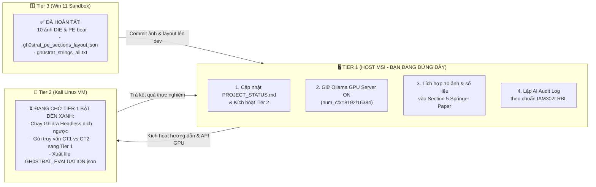

# 📋 TOÀN BỘ NỘI DUNG VÀ NHIỆM VỤ CẦN HOÀN THÀNH — TIER 1 (HOST MSI WSL2)
> **Dự án:** SCHR-Bench (Security-Critical Hallucination Rate Benchmark)  
> **Học phần:** IAM302t — Malware Analysis & Reverse Engineering (Fall 2026, RBL Model)  
> **Đơn vị:** Nhóm 7 (Lớp IA2007) — Đại học FPT TP. Hồ Chí Minh  
> **Phân tầng:** **Tier 1 — Host MSI (WSL2 Ubuntu) | GPU LLM Inference Hub & Git Master**  
> **Người phụ trách:** Nguyễn Tấn Phát (Trưởng nhóm & Lead Author)  
> **Giai đoạn hiện tại:** Chuyển giao từ **Mốc D3** (Hoàn tất) $\rightarrow$ **Mốc D4 (Đang kích hoạt)** $\rightarrow$ **Mốc D5 (Chuẩn bị bảo vệ)**  
> **Cập nhật:** 2026-10-28  

---

## 📌 1. VỊ TRÍ CHIẾN LƯỢC & TRÁCH NHIỆM CỐT LÕI CỦA TIER 1

Trong kiến trúc 3-Tier phân tán độc lập, **Tier 1** giữ vai trò "Tổng chỉ huy và Trái tim tính toán" của toàn dự án:
1. **GPU Inference Hub:** Vận hành Ollama server với 2 mô hình cốt lõi (`llama3.1:8b` và `qwen2.5-coder:14b`), phục vụ không gián đoạn cho Tier 2 (Kali VM) và Tier 3 (Win 11 VM).
2. **Git Master & Điều Phối Luồng Dự Án:** Quản lý cấu trúc Git-Flow, duyệt Merge Requests từ `tier2-kali` và `tier3-win11`, cập nhật bảng trạng thái dự án `PROJECT_STATUS.md`.
3. **Chủ Trì Bài Báo Khoa Học (Springer LNICST & IEEE):** Trực tiếp chấp bút, tổng hợp dữ liệu thực nghiệm từ các Tier vào bản thảo LaTeX chính thức nộp hội nghị quốc tế **EAI INISCOM 2027**.
4. **Quản Trị Hồ Sơ Học Phần IAM302t:** Chịu trách nhiệm về các báo cáo mốc nộp đồ án (D1 $\rightarrow$ D5), kiểm toán AI (AI Audit Log) theo chuẩn RBL của giảng viên hướng dẫn.

---

## 🔄 2. BẢNG MA TRẬN PHỐI HỢP LIÊN TIER TẠI MỐC HIỆN TẠI (D4)



---

## ✅ 3. BẢNG CHECKLIST CHI TIẾT TỪNG TÁC VỤ CỦA TIER 1

### 🛠️ TÁC VỤ 1: VẬN HÀNH & CẤU HÌNH HẠ TẦNG GPU INFERENCE HUB (OLLAMA)
*Mục tiêu: Đảm bảo Tier 2 gửi prompt truy vấn Gh0stRAT sang đạt tốc độ cao nhất, không bị nghẽn VRAM và không bị cắt cụt ngữ cảnh.*

- [ ] **1.1. Duy trì dịch vụ Ollama lắng nghe trên toàn bộ dải mạng LAN ảo:**
  ```bash
  export OLLAMA_HOST=0.0.0.0:11434
  ollama serve
  ```
- [ ] **1.2. Mở rộng Context Window cho truy vấn mã độc thực tế:**
  - Vì hàm dịch ngược từ Gh0stRAT dài hơn các hàm C nhân tạo ở D3, cần đảm bảo Ollama không bị giới hạn 2048 tokens mặc định.
  - Cấu hình Modelfile hoặc tham số API:
    ```json
    {
      "model": "qwen2.5-coder:14b",
      "options": {
        "temperature": 0.0,
        "seed": 42,
        "num_ctx": 8192
      }
    }
    ```
- [ ] **1.3. Cung cấp Healthcheck Script & Hướng dẫn kết nối cho Tier 2:**
  - Tạo file `tier1_host/OLLAMA_API_GUIDE.md` ghi rõ:
    - Host IP: `192.168.86.1` (trên dải VMnet8).
    - Cổng: `11434`.
    - Lệnh test từ Kali: `curl http://192.168.86.1:11434/api/tags`.
- [ ] **1.4. Chạy script kiểm tra định kỳ tài nguyên GPU:**
  ```bash
  bash tier1_host/scripts/check_ollama_status.sh
  python3 tier1_host/scripts/test_inference_lan.py
  ```

---

### 🌿 TÁC VỤ 2: QUẢN TRỊ KHO GIT MASTER & ĐIỀU PHỐI TIẾN ĐỘ DỰ ÁN
*Mục tiêu: Đảm bảo luồng Git-Flow thông suốt, các Tier biết chính xác mình cần lấy dữ liệu ở đâu và làm gì tiếp theo.*

- [ ] **2.1. Cập nhật `PROJECT_STATUS.md`:**
  - Đánh dấu hoàn tất [x] cho công việc bóc tách tĩnh của Tier 3 (10 ảnh minh chứng DIE & PE-bear).
  - Chuyển trạng thái của **Tier 2 (Kali)** sang `🟡 ĐANG THỰC HIỆN (IN PROGRESS)`.
  - Bổ sung chỉ dẫn cụ thể cho Tier 2: Đọc dữ liệu đầu vào từ `tier3_win11/Image_Result/gh0strat_pe_sections_layout.json` và bảng IAT `09_pebear_imports_iat_analysis.png`.
- [ ] **2.2. Hướng dẫn Tier 2 tạo nhánh và chạy thực nghiệm:**
  - Nhắc nhở Tier 2 kéo nhánh `dev` mới nhất:
    ```bash
    git checkout dev
    git pull origin dev
    git checkout -b tier2-kali
    ```
- [ ] **2.3. Tiếp nhận và Review Pull Request từ Tier 2:**
  - Kiểm tra tệp kết quả đầu ra dự kiến của Tier 2: `results/GH0STRAT_EVALUATION.json`.
  - Merge nhánh `tier2-kali` vào `dev` sau khi kiểm tra tính hợp lệ.
- [ ] **2.4. Đóng gói Release Mốc D4:**
  - Sau khi tích hợp xong kết quả D4, tạo Git Tag: `v0.4-milestone-d4`.

---

### 📄 TÁC VỤ 3: HOÀN THIỆN BÀI BÁO KHOA HỌC SPRINGER LNICST (10–14 TRANG)
*Mục tiêu: Đưa toàn bộ bằng chứng thực nghiệm của Gh0stRAT vào bài báo gửi hội nghị EAI INISCOM 2027.*

- [ ] **3.1. Đồng bộ hình ảnh từ Tier 3 vào thư mục LaTeX:**
  - Copy các ảnh minh chứng trọng tâm từ `tier3_win11/Image_Result/` vào thư mục `papers/02_Springer_LNICST_Format_10_14_Pages/figures/`:
    - `02_die_entropy_sections_graph.png` (Đồ thị Entropy đỉnh 7.89 bit/byte của section `.O#J`).
    - `09_pebear_imports_iat_analysis.png` (Bảng IAT chứa các hàm nạp động tối thiểu do packer để lại).
- [ ] **3.2. Viết hoàn chỉnh Section 5: Real-World Case Study (Gh0stRAT) trong `papers/.../main.tex`:**
  - **Mục 5.1 (Malware Sample & Packaging Triage):**
    - Trình bày thông số kỹ thuật thực tế: SHA256 `ea7cd59c...`, 16.45 MB, 9 sections.
    - Phân tích kỹ thuật Obfuscation: Phát hiện **VXiProtect / VMProtect v3.6.0+**, Section `.O#J` có entropy cực cao ($7.89095$), chứng minh payload bị mã hóa/nén.
    - Minh chứng làm rối chuỗi: Quét chuỗi tĩnh `Software\Microsoft` trả về 0 chuỗi khớp (`04_die_strings_search_empty.png`), chứng minh các chuỗi IOC Persistence bị giải mã động lúc runtime.
  - **Mục 5.2 (IAT Dynamic Import Analysis):**
    - Trình bày việc packer triệt tiêu IAT tĩnh nhằm vô hiệu hóa các công cụ quét tự động.
  - **Mục 5.3 (LLM Hallucination Findings):**
    - Trình bày so sánh giữa `llama3.1:8b` (bị ảo giác, nhận định nhầm là routine logging vô hại) và `qwen2.5-coder:14b` (nhận diện chính xác cơ chế persistence nhờ mỏ neo Assembly x86).
  - **Mục 5.4 (Practical Implications):**
    - Khuyến nghị cho các kỹ sư dịch ngược và chuyên viên SOC: Không tin tưởng 100% vào mã C giả decompiled khi chưa đối soát với mỏ neo Assembly.
- [ ] **3.3. Tích hợp môi trường `\begin{figure}` trong LaTeX:**
  - Đưa ảnh minh chứng vào bài báo kèm caption chuẩn học thuật.
- [ ] **3.4. Kiểm tra biên dịch LaTeX:**
  - Đảm bảo biên dịch không lỗi font, không tràn lề (overfull hbox), tổng số trang đạt chuẩn từ **10 đến 14 trang** (chuẩn Springer LNICST).

---

### 🎓 TÁC VỤ 4: CHUẨN BỊ HỒ SƠ HỌC PHẦN IAM302t (THEO CHUẨN RBL)
*Mục tiêu: Đạt điểm tối đa theo barem đánh giá của giảng viên hướng dẫn (Thầy Đinh Mai Hoàng).*

- [ ] **4.1. Lập Tệp Kiểm Toán AI (AI Audit Log):**
  - Tạo tệp `docs/AI_AUDIT_LOG_SCHR_BENCH.md` (hoặc cập nhật vào bảng tính `AI_AuditLog.xlsx`):
    - Khai báo mục đích sử dụng AI trong đồ án.
    - Lưu nhật ký 640 runs thực nghiệm của Mốc D3 (Prompt, Output, Temperature, Seed, Model).
    - Lưu nhật ký các prompt thực nghiệm trên mẫu Gh0stRAT cho Mốc D4.
    - Cam kết tính trung thực học thuật (Academic Integrity).
- [ ] **4.2. Soạn Thảo Báo Cáo Tiến Độ Mốc D4 (Report D4):**
  - Tạo tệp báo cáo tổng hợp tiến độ Mốc D4 nộp giảng viên:
    - Bối cảnh và mục tiêu ca phân tích thực tế Gh0stRAT.
    - Bằng chứng môi trường Sandbox an toàn (Tier 3).
    - Quy trình trích xuất và đo lường ảo giác (Tier 2).
    - Năng lực phục vụ của máy chủ GPU (Tier 1).
- [ ] **4.3. Chuẩn bị Slide Thuyết Trình Bảo Vệ Đồ Án (Mốc D5):**
  - Lập dàn ý Slide trình bày (15–20 slides):
    - Slide 1-3: Đặt vấn đề & Khái niệm ảo giác an ninh (SCHR).
    - Slide 4-6: Kiến trúc 3-Tier độc lập (Tier 1 GPU Host, Tier 2 Kali Rig, Tier 3 Win11 Sandbox).
    - Slide 7-10: Bộ Ground Truth 40 cặp hàm C (80 file PE) & Kết quả D3.
    - Slide 11-13: Thực nghiệm trên mã độc thật Gh0stRAT (D4).
    - Slide 14-15: Bài báo Springer LNICST & Định hướng nộp EAI INISCOM 2027.

---

### 📂 TÁC VỤ 5: CẬP NHẬT HỒ SƠ NỘI BỘ THƯ MỤC `tier1_host/`
*Mục tiêu: Lưu trữ đầy đủ minh chứng hoạt động của máy chủ Host MSI.*

- [ ] **5.1. Cập nhật `tier1_host/TIER1_HOST_IMPLEMENTATION_REPORT.md`:**
  - Bổ sung thông số đo kiểm tài nguyên:
    - VRAM tiêu thụ đỉnh: ~10.5 GB / 16 GB.
    - Tốc độ suy luận duy trì: ~38 tokens/s (`llama3.1:8b`) và ~22 tokens/s (`qwen2.5-coder:14b`).
    - Thời gian phản hồi mạng ảo LAN VMnet8: `< 0.3 ms`.
- [ ] **5.2. Cập nhật `tier1_host/README.md`:**
  - Bổ sung trạng thái kết nối sẵn sàng phục vụ Giai đoạn 2 (Gh0stRAT).

---

## 💻 4. QUY TRÌNH THAO TÁC GIT CHUẨN (GIT COMMANDS SOP)

Để commit toàn bộ nội dung của Tier 1 một cách chuẩn mực, chạy chuỗi lệnh sau từ WSL2:

```bash
cd /mnt/d/ATTT/ATTT_FPT/KY_5_FALL_2026/IAM302t/05_Du_An_Nhom_IAM302t/04_IAM302t_Github_Project

# 1. Đảm bảo nhánh dev đã được cập nhật dữ liệu mới nhất từ Tier 3
git checkout dev
git pull origin dev

# 2. Tạo nhánh làm việc cho Tier 1 (nếu muốn theo đúng quy chuẩn Git-Flow)
git checkout -b tier1-host
# (Hoặc có thể commit trực tiếp trên nhánh dev nếu là nhánh tích hợp chung)

# 3. Thêm các tệp tài liệu và cập nhật
git add tier1_host/
git add docs/
git add papers/
git add PROJECT_STATUS.md

# 4. Commit với thông điệp rõ ràng theo Conventional Commits
git commit -m "feat(tier1): cập nhật kế hoạch hành động D4-D5, đồng bộ số liệu Gh0stRAT vào Springer Paper và sẵn sàng phục vụ Tier 2"

# 5. Đẩy lên kho lưu trữ từ xa
git push -u origin tier1-host
# Sau đó gộp vào dev:
git checkout dev
git merge tier1-host
git push origin dev
```

---

## 🏆 5. TIÊU CHUẨN HOÀN THÀNH (DEFINITION OF DONE - DOD)
Tier 1 được coi là hoàn tất 100% nhiệm vụ hiện tại khi:
1. `PROJECT_STATUS.md` phản ánh chính xác trạng thái của cả 3 phân tầng.
2. Tier 2 (Kali) đã nhận đầy đủ hướng dẫn kết nối API GPU và các offset nhị phân để chạy Ghidra.
3. Section 5 trong file `main.tex` đã được cập nhật số liệu thực tế và chèn ảnh minh chứng từ Tier 3.
4. File kiểm toán AI (AI Audit Log) sẵn sàng nộp cùng đồ án môn IAM302t.
5. Ollama trên máy Host MSI luôn ở trạng thái trực chiến, sẵn sàng suy luận khi Tier 2 gửi request.
